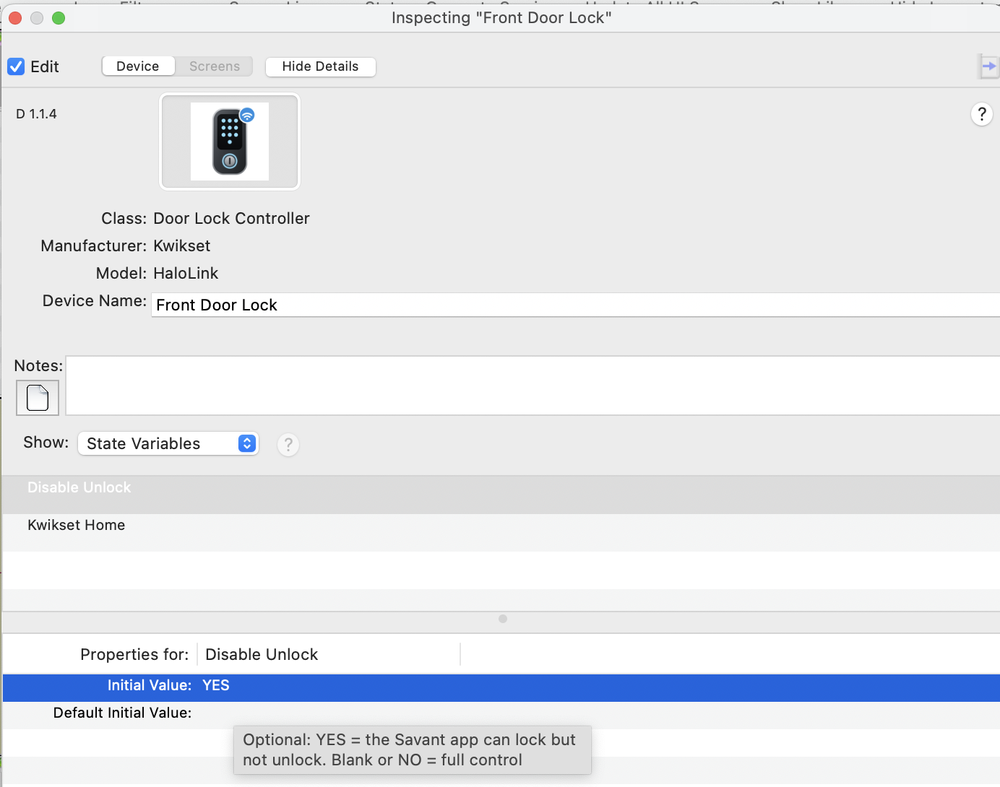
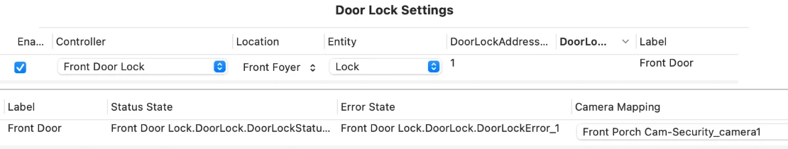
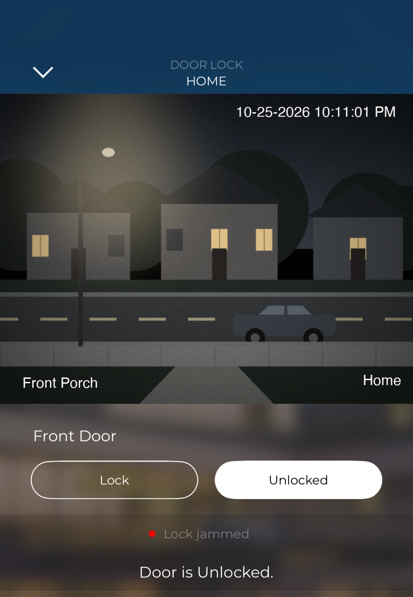

# HaloKey — User Manual

**Version 1.1.7** · Kwikset Halo Wi-Fi smart locks in Savant: lock and unlock from the Savant app, live status, battery, and who locked or unlocked the door.

*HaloKey is an independent community project. It is not affiliated with, endorsed by, or supported by Kwikset or Savant Systems, Inc. "Savant" and "Kwikset" are trademarks of their owners. Released under the MIT License.*


---

## Contents

1. [What it does](#1-what-it-does)
2. [How it works](#2-how-it-works)
3. [Requirements](#3-requirements)
4. [Quick start](#4-quick-start)
5. [Installing the bridge](#5-installing-the-bridge)
6. [Signing in to Kwikset](#6-signing-in-to-kwikset)
7. [Lock numbers](#7-lock-numbers)
8. [Adding the profile in Blueprint](#8-adding-the-profile-in-blueprint)
9. [The Door Lock data table](#9-the-door-lock-data-table)
10. [Programming](#10-programming)
11. [Security and unlock control](#11-security-and-unlock-control)
12. [Managing the bridge](#12-managing-the-bridge)
13. [Troubleshooting](#13-troubleshooting)
14. [FAQ](#14-faq)
15. [Developer reference](#15-developer-reference)
16. [Appendix A — State reference](#appendix-a--state-reference)

---

## 1. What it does

- **Lock and unlock** from the Savant app's Door Lock screen, buttons, scenes and triggers, plus **Lock All** for Goodnight and Away scenes.
- **Live status**: Kwikset pushes every change in real time (a few seconds), with a safety poll every 5 minutes.
- **Who did it**: each change is labelled Keypad, Manual (thumb turn or key), App or Savant, with the user code's name or the phone's name when Kwikset knows it.
- **Battery** level and low-battery flag, **online/offline**, **jammed**, and the door position sensor on locks that have one.
- Lock settings: status LED, lock sounds, secure screen, auto-lock and its delay.
- One component covers **up to 8 locks** on a Kwikset account (more on request, see [section 15](#15-developer-reference)).

**Tested on:** the original Kwikset Halo Touchscreen Wi-Fi Smart Lock (model HALO-01, firmware 02.09.10.10) with a Savant Mac mini Pro host (macOS, Python 3.9.6) and the Savant Pro app. Halo Touch, Halo Select and Halo Select Plus use the same Kwikset cloud and should work, but haven't been tested. On another model, a lock or unlock method the bridge doesn't recognise yet (such as a fingerprint on Halo Touch) shows `LAST_SOURCE` *Unknown*; please open an [issue on GitHub](https://github.com/jwheeler188/HaloKey/issues) with the output of `halolink dump <n>` (it hides your email and phone). **Not supported:** Bluetooth-only Kwikset locks (Aura) and Z-Wave/Zigbee Kwikset locks, which don't use the Kwikset cloud.

## 2. How it works

```
Kwikset lock --Wi-Fi--> Kwikset cloud <--HTTPS/WSS--> HaloKey bridge <--TCP 2370--> Savant
```

1. **The bridge** is a small Python service that runs on the Savant host (or another always-on computer). It signs in to the Kwikset cloud with the open-source [aiokwikset](https://github.com/explosivo22/aiokwikset) library, the same cloud the Kwikset app uses, and keeps a live push connection open.
2. **The Blueprint profile** connects to the bridge on TCP port **2370**. The bridge sends one `KEY=value` line per state; Savant sends commands such as `LOCK 1`.

Savant has no Kwikset integration of its own, so **the bridge must be running** for the profile to show anything.

**Names:** HaloKey was developed as *HaloLink*, and the technical names keep that: the Blueprint profile (**Kwikset HaloLink**, `kwikset_halolink.xml`), the bridge service, the `halolink` command and the `~/HaloLink` folder. Existing installs keep working with no changes.

## 3. Requirements

- A Savant host. The installer is for the **Mac mini Pro host** (macOS, Python 3.9.6, already present). A Linux computer also works (`linux/halolink-bridge.service`).
- Internet access from the bridge: the Kwikset cloud, plus PyPI once during install.
- Locks already set up and working in the **Kwikset app**, on Wi-Fi.
- The login for the Kwikset account that owns the locks, or one the home has been shared with. Kwikset sends a verification code to that account's email or phone during sign-in, so someone needs to be able to read it.

**Which account?** Kwikset records commands from the bridge in the lock's history under the account holder's first name (HaloKey reports these as source *Savant*). To keep Savant's actions apart from the homeowner's own, have the owner share the home with admin access to a separate account, and sign the bridge in with that one.

## 4. Quick start

On the Savant host:

```
cd HaloKey/macos
sudo ./install.sh
halolink login
halolink list
```

Then in Blueprint:

1. Import `profile/blueprint-import/kwikset_halolink.xml` (keep the file name).
2. Add **Kwikset HaloLink** to the layout and set its Ethernet IP to the host.
3. In the Door Lock data table, add one Lock per lock: address = the lock number, Status State `DoorLockStatus_n`, Error State `DoorLockError_n`.
4. Upload.

## 5. Installing the bridge

### 5.1 On the Savant Mac mini Pro host (recommended)

1. Copy the `HaloKey` folder (from the release zip or a `git clone`) to the host, for example to the Desktop.
2. Open Terminal and run:
   ```
   cd ~/Desktop/HaloKey/macos
   sudo ./install.sh
   ```
   To run the service as a different macOS user than the one you're logged in as (for example `RPM`), use `sudo ./install.sh --user RPM`.
3. The installer:
   1. Checks for Python 3.9+
   2. Copies the bridge to `~/HaloLink`
   3. Creates a private Python environment in `~/HaloLink/venv` and downloads aiokwikset's packages (aiohttp, boto3, pycognito, attrs). This takes a minute or two the first time.
   4. Installs the bundled Python 3.9-compatible aiokwikset (see [section 15](#15-developer-reference))
   5. Starts the service at boot through launchd, adds a macOS firewall exception if the firewall is on, and adds the `halolink` command

   Nothing outside `~/HaloLink`, the launchd plist and `/usr/local/bin/halolink` is touched, and Savant's own Python and files are left alone.
4. To upgrade later, run `install.sh` from the new release. Your settings, Kwikset sign-in and lock numbering are kept.

Over SSH, run the command by its full path, because a remote command doesn't search `/usr/local/bin`: `ssh -t rpm@<host> '/usr/local/bin/halolink status'`.

### 5.2 On another computer (Linux, Raspberry Pi, another Mac)

Follow the steps in the comments of `linux/halolink-bridge.service`. Then, in the bridge's `config.json`, set `allowed_clients` to the Savant host's IP (for example `["192.168.1.20"]`), or the bridge refuses Savant's connection. Give the host a fixed IP or DHCP reservation. In Blueprint, point the component's Ethernet IP at this computer instead of the host.

### 5.3 The bridge's configuration file

`~/HaloLink/config.json`. After editing, run `sudo halolink restart`.

| Key | Default | Purpose |
|---|---|---|
| `tcp_port` | 2370 | Savant connection port. The profile expects 2370 |
| `max_locks` | 8 | Lock slots. For more than 8, also regenerate the profile (section 15) |
| `poll_seconds` | 300 | Safety poll interval (minimum 30). Real-time push covers normal changes |
| `realtime` | true | Kwikset real-time push. `SYS_LIVE` shows whether it's connected |
| `home` | "" | Only locks in this Kwikset home. Blank = every home. The Blueprint *Kwikset Home* variable overrides this |
| `lock_order` | [] | Fixed numbering by lock name (section 7) |
| `allowed_clients` | "auto" | Who may connect and control the locks (section 11) |
| `allow_remote_unlock` | true | `false` blocks unlocking from Savant, whatever Blueprint says (section 11) |
| `battery_low_percent` | 20 | `LOCKn_BATTERY_LOW` threshold |
| `confirm_seconds` | 45 | How long to wait for a lock to confirm a command |
| `log_level` | INFO | `DEBUG` logs every push from Kwikset |

## 6. Signing in to Kwikset

1. Run `halolink login` on the bridge machine.
2. Enter the Kwikset email and password.
3. Choose where Kwikset should send the verification code: email or text.
4. Enter the code. You'll see the homes and locks on the account.

The password is used once and is **never stored**. Only Kwikset's session tokens are saved, in `~/HaloLink/tokens.json`, readable by the service user only. The running bridge picks up the new sign-in immediately, and the session renews itself.

If Kwikset ever ends the session (for example after a password change), `SYS_AUTH` changes to `reauth_required` in Savant. Run `halolink login` again.

> Signing in from the Savant Pro app's Settings > Devices screen isn't possible: Savant only offers that screen to its own cloud partners (such as August) and its own built-in services.

## 7. Lock numbers

```
halolink list
```
```
  #  name                     status    batt  door     device id
  1  Back Door                Locked      60  Unknown  ...
  2  Front Door               Locked      88  Closed   ...
```

Savant refers to locks **by these numbers**: `LOCK2_STATUS`, `LockDoor2`, Door Lock address `2`.

- Numbers are given out alphabetically the first time and then **never change**, even if locks are renamed, removed or added. They're saved in `~/HaloLink/locks.json`.
- To set the order yourself, put names in `lock_order` in `config.json` (for example `["Front Door", "Garage Entry", "Back Door"]`), delete `locks.json`, and restart with `sudo halolink restart`.
- If you add a lock in the Kwikset app later, run the profile's `RefreshLocks` action (or restart the bridge) and it gets the next free number.

## 8. Adding the profile in Blueprint

1. In Blueprint's component library, **Import** `profile/blueprint-import/kwikset_halolink.xml`. The folder holds three files with the same name: the profile (`.xml`), this manual as the component's **Documentation** tab (`.htm`) and the component icon (`.icns`). Blueprint copies the `.htm` and `.icns` it finds beside the profile into your library, so import from that folder and keep the three files together.
   - **Keep the file name exactly as shipped.** Blueprint finds profiles by manufacturer and model. A renamed copy, such as `kwikset_halolink (1).xml`, imports but then fails with "Component not found."
   - When upgrading, import the new version the same way. Every release that changes the profile raises its version, so Blueprint replaces the old one cleanly.
2. Search the library for *Kwikset*, *Halo* or *HaloKey* (*Halo Touch*, *Halo Select*, *Smart Lock* and *Deadbolt* work too) and drag **Kwikset HaloLink** into the layout. It's added as **Door Lock Controller**; rename it if you like. Connect its **Ethernet** port to the network, as you would any IP device.
3. Select the component, go to Inspector, **Show: Control Ports**, then *Ethernet*, and set **Device IP Address** to the machine running the bridge. On the Mac host that's the host's own IP (`ipconfig getifaddr en0`). The port, 2370, is set by the profile.
4. Optional, under **Show: State Variables**:
   - **Kwikset Home**: the home's name from the Kwikset app, if the account has more than one home. Blank uses `home` in `config.json` (blank there means every home). `ALL` forces every home.
   - **Disable Unlock**: `YES` makes Savant lock-only. Blank or `NO` gives full control (section 11).
5. Fill in the Door Lock data table (section 9), then upload. Run `halolink status` on the host to watch the locks come in.



## 9. The Door Lock data table

The profile's Door Lock section follows Savant's own August Smart Lock profile: device class `DoorLock_controller`, `LockDoorLock` / `UnlockDoorLock`, and a Lock entity that queries `GetLockStatus` at startup and once a day.

One difference: August needs **one profile instance per lock**. HaloKey uses **one instance for every lock on the account**, and the entity's address picks the lock. Add one row per lock:

| Column | Value |
|---|---|
| Controller | This Kwikset HaloLink component |
| Location | The zone the lock belongs to |
| Entity | Lock |
| DoorLockAddress [1] | The lock number from `halolink list` (1, 2, 3 …) |
| Label | The name shown in the Savant app, for example *Front Door* |
| Status State | `[component name].DoorLock.DoorLockStatus_n` |
| Error State | `[component name].DoorLock.DoorLockError_n` |
| Camera Mapping | Optional: a camera to show with the lock |

`n` is the lock's number. For lock 1 on a component named *Front Door Lock*: Status State `Front Door Lock.DoorLock.DoorLockStatus_1`, Error State `Front Door Lock.DoorLock.DoorLockError_1`.



> Use `DoorLockStatus_n` (Locked / Unlocked) for Status State, not `IsDoorLocked_n`: with the true/false state, the Savant app shows *Unlocked* while the door is locked. The app shows Error State in red, which is why `DoorLockError_n` stays blank unless something is wrong: *Lock offline*, *Lock jammed*, or why the last command failed.

## 10. Programming

### 10.1 Actions

| Action | Arguments | What it does |
|---|---|---|
| `LockDoor1` … `LockDoor8` | none | Lock that lock. Use these for buttons, scenes and triggers |
| `UnlockDoor1` … `UnlockDoor8` | none | Unlock that lock |
| `LockDoor` / `UnlockDoor` | Lock (number or exact name) | Same, with the lock as an argument |
| `LockAllDoors` | none | Lock every lock that isn't already Locked (Goodnight / Away scenes) |
| `SetStatusLED` / `SetLockSounds` / `SetSecureScreen` | Lock, State `ON`/`OFF` | Lock settings |
| `SetAutoLock` | Lock, Seconds: `OFF` or 15, 30, 60, 180, 300, 600, 1500 | Auto-lock on/off and delay |
| `RefreshLocks` | none | Fetch fresh status now; also picks up newly added locks |
| `RequestAllStates` | none | Resend every state. Runs automatically at startup |

### 10.2 States most programs need

The full list is in [Appendix A](#appendix-a--state-reference). `n` = lock number.

| State | Values |
|---|---|
| `LOCKn_STATUS` | Locked, Unlocked, Jammed, Unknown (Unknown while the lock is offline) |
| `LOCKn_LOCKED` | 1 / 0 |
| `LOCKn_PENDING` | `Locking` / `Unlocking` while a command is being confirmed, otherwise blank |
| `LOCKn_ERROR` | Why the last command failed (blank when fine) |
| `LOCKn_LAST_EVENT`, `LOCKn_LAST_SOURCE`, `LOCKn_LAST_USER` | Who did it: Locked/Unlocked, by Keypad / Manual / App / Savant, and the user code's or phone's name |
| `LOCKn_BATTERY`, `LOCKn_BATTERY_LOW` | Percent; 1 at or below 20% (`battery_low_percent`) |
| `LOCKn_ONLINE`, `LOCKn_LAST_KNOWN` | 1 / 0; the last status the lock reported, kept while it's offline |
| `LOCKn_DOOR`, `LOCKn_DOOR_OPEN` | Open / Closed / Unknown (locks with the door position sensor) |
| `SYS_ALL_LOCKED` | 1 when every lock reports Locked |
| `SYS_UNLOCKED_NAMES`, `SYS_LOW_BATTERY_NAMES` | Comma-separated lock names, ready for a notification |
| `SYS_UNLOCK_ALLOWED` | 1 when Savant may unlock (section 11): show or hide an Unlock button |
| `SYS_ONLINE`, `SYS_AUTH`, `SYS_LIVE` | Bridge health. Gate automations on `SYS_ONLINE = 1` |

### 10.3 Example triggers

1. **Unlocked reminder at night:** at 10:30 PM, if `SYS_ALL_LOCKED = 0`, send a notification "Still unlocked: `SYS_UNLOCKED_NAMES`" and/or run `LockAllDoors`.
2. **Welcome home:** when `LOCK1_LAST_SOURCE` = Keypad and `LOCK1_LAST_EVENT` = Unlocked, run the entry lighting scene. Use `LOCK1_LAST_USER` to tell family codes from a guest code.
3. **Low battery:** when `SYS_LOW_BATTERY_COUNT` goes above 0, notify "Replace batteries: `SYS_LOW_BATTERY_NAMES`".
4. **Lock problem:** when `DoorLockError_1` is not blank, notify "Front door: `DoorLockError_1`" (offline, jammed, or a failed command).
5. **Re-sign-in needed:** when `SYS_AUTH` = `reauth_required`, notify the integrator.

### 10.4 How lock state works

The bridge never assumes a lock moved because a button was pressed. After a command, `LOCKn_PENDING` shows `Locking`/`Unlocking` until Kwikset reports the new state, typically 5 to 10 seconds. If the lock doesn't confirm within 45 seconds (`confirm_seconds`), `LOCKn_ERROR` says so and the status stays at what Kwikset last reported. While a lock is offline (dead batteries, Wi-Fi down), its status is *Unknown* rather than a possibly stale *Locked*.

**Who did it** comes from the lock's Kwikset history, read a couple of seconds after each change, because the live push doesn't say. A jam reaches the history late, so `LOCKn_LAST_SOURCE` may stay on the previous event; `LOCKn_STATUS` and `DoorLockError_n` still show the jam straight away.



## 11. Security and unlock control

### 11.1 Unlocking from Savant

Savant has **full control by default**: lock and unlock. Two ways to make it lock-only:

- **Disable Unlock** state variable in Blueprint = `YES`. Easy to change from Blueprint. The bridge remembers it across restarts.
- `"allow_remote_unlock": false` in the bridge's `config.json`. A host-level block that Blueprint can't override.

Blueprint can only turn unlocking off, never back on past the config file. A refused unlock never reaches Kwikset; the Savant app shows why in red (Error State), and `SYS_UNLOCK_ALLOWED` = 0.

### 11.2 Who can connect (`allowed_clients`)

The Savant-to-bridge connection (port 2370) is plain TCP with no password, like most Savant IP profiles. Anything that can connect to it can send a lock or unlock. `allowed_clients` limits which devices may connect.

- **`"auto"` (default):** only the machine the bridge runs on. With the bridge on the Savant host, Savant connects from the host itself, so this needs no setup. The host's IP changing doesn't matter.
- **Bridge on a separate machine:** list the Savant host's IP, for example `["192.168.1.20"]`.
- Entries can be combined and can be subnets: `["auto", "192.168.1.20", "10.0.5.0/24"]`.
- **`"any"`** turns the restriction off. Not recommended; the bridge logs a warning at every start.

This setting is **only** in `config.json` on the host, never in the Blueprint profile: the profile talks to the bridge over that same unsecured connection, so if it could set who's allowed in, anyone who could connect could let themselves in. Refused connections are closed before anything is read or sent, logged (once per IP every 5 minutes), and shown in `SYS_REJECTED_CLIENT`. It can't stop an attacker who can already take over the host's own IP address, so keep the control network properly segmented.

### 11.3 The Kwikset account

- Sign-in uses Kwikset's own AWS Cognito sign-in (SRP), so the password never leaves the host and is never saved.
- `tokens.json` gives access to the Kwikset account until Kwikset ends the session. It's readable only by the service user; treat the host accordingly.
- Everything the bridge contacts is Kwikset's AWS endpoints over TLS. Nothing else.
- HaloKey uses Kwikset's cloud API, which Kwikset doesn't publish or support for third parties, so a Kwikset change could break it.

## 12. Managing the bridge

### 12.1 The `halolink` command (macOS)

| Command | |
|---|---|
| `halolink status` | Service, Kwikset sign-in, and each lock's status, battery and errors |
| `halolink login` | Sign in to Kwikset (section 6) |
| `halolink list` | Locks and their numbers |
| `halolink lock 2` / `halolink unlock 2` | Test a lock from Terminal through the running bridge |
| `halolink refresh` | Fetch fresh status now |
| `halolink dump 2` | Raw Kwikset data and recent history for lock 2, for troubleshooting (email and phone hidden) |
| `halolink logs` | Follow the log (Ctrl-C to quit) |
| `sudo halolink stop` / `start` / `restart` | Clean stop and start. A stop lasts until start or reboot |
| `sudo halolink disable` / `enable` | Don't start / start again at boot |
| `sudo halolink uninstall` | Remove everything. Add `--keep-config` to back up settings, sign-in and numbering |

Logs: `~/HaloLink/logs/bridge.log` (rotated, 3 × 1 MB).

### 12.2 Uninstalling

`sudo halolink uninstall` (or `sudo ~/HaloLink/uninstall.sh`) stops the service and removes `~/HaloLink`, the launchd plist and the `halolink` command. With `--keep-config`, settings, the Kwikset sign-in and lock numbering are saved to a `HaloLink-backup-*` folder that the next install restores. It only ever deletes a folder named `HaloLink`.

## 13. Troubleshooting

| Symptom | Check |
|---|---|
| `SYS_AUTH = login_required` | Run `halolink login` |
| `SYS_AUTH = reauth_required` | Kwikset ended the session. Run `halolink login` again |
| `SYS_ONLINE = 0`, `SYS_ERROR` says unreachable | Bridge internet / DNS. The bridge retries on its own (30 s, backing off to 10 min) |
| `SYS_LIVE = 0` | Real-time push is down. Status still updates by polling every `poll_seconds` |
| The Savant app shows *Unlocked* while the door is locked | Status State must be `DoorLockStatus_n`, not `IsDoorLocked_n` (section 9) |
| A red line under the lock in the app | That's `DoorLockError_n`: *Lock offline* (check batteries and Wi-Fi in the Kwikset app), *Lock jammed*, or a refused or failed command |
| Unlock does nothing | The red line says why. Check the **Disable Unlock** variable and `allow_remote_unlock` (section 11) |
| A lock shows *Unknown* / `LOCKn_ONLINE = 0` | The Kwikset app shows the same lock offline. Low batteries are the usual cause |
| A lock is missing | `halolink list`. Check the `home` filter and the *Kwikset Home* variable. More than `max_locks` locks? |
| Profile shows nothing | The Ethernet IP must be the bridge machine's. Run `halolink status` and check that port 2370 is listening. If the bridge runs on a separate machine, check `allowed_clients` and look for "refused connection" in `halolink logs` |
| The Documentation tab is greyed out, or the icon is a *?* | Import the profile from `profile/blueprint-import/`, with `kwikset_halolink.htm` and `.icns` beside it (section 8). A component added before the icon was in the library keeps the *?*: remove it and add it again |
| Import or "Component not found" problems | Build the 5-state test profile with `generate_profile.py --test` and import `profile/kwikset_halolinktest.xml`, to tell a profile-structure problem from a content problem |
| A state looks wrong (door, online) | Run `halolink dump <n>` and look at the raw fields. Kwikset's field names can vary by model and firmware |

## 14. FAQ

**Does it work without the internet?** No. Kwikset Wi-Fi locks are controlled through the Kwikset cloud. The lock's keypad and key always work locally.

**How fast is it?** A command from Savant moves the lock and comes back as confirmed status in about 5 to 10 seconds. Changes made at the door (keypad, thumb turn) reach Savant in a few seconds by push.

**Does polling drain the batteries?** It shouldn't: the 5-minute poll asks Kwikset's cloud for the lock's last report, and live push does the real work. Kwikset doesn't document whether the cloud wakes the lock, so if batteries drain faster than usual, raise `poll_seconds` (for example to 1800).

**Can I see who unlocked the door?** Yes: `LOCKn_LAST_SOURCE` (Keypad / Manual / App / Savant) and `LOCKn_LAST_USER` (the user code's name, or the phone's name for the Kwikset app).

**What about Halo Select / Matter?** Halo Select and Select Plus locks support Matter, a local, official interface. HaloKey doesn't use it: the Savant host isn't a Matter controller, and the original Halo and Halo Touch don't support Matter.

## 15. Developer reference

### 15.1 Files

```
bridge/halolink_bridge.py     the bridge (single file, asyncio)
bridge/config.json            default settings
profile/generate_profile.py   builds the Blueprint profile, the Documentation tab page and STATES.md
profile/blueprint-import/     import package: kwikset_halolink .xml (profile), .htm (Documentation tab), .icns (icon)
profile/icon.svg              icon source; make_icon.sh builds blueprint-import/kwikset_halolink.icns (macOS)
macos/                        install.sh, uninstall.sh, halolink control command
linux/                        systemd unit and setup steps
vendor/                       Python 3.9-compatible aiokwikset wheel and the script that makes it
tests/                        end-to-end tests against a simulated Kwikset cloud
docs/images/                  screenshots used in this manual
```

### 15.2 Protocol (TCP 2370)

Lines end with LF. The bridge sends `KEY=value` lines, changes only; a new connection gets every state. Savant sends:

`LOCK n`, `UNLOCK n`, `LOCKALL`, `STATUS n`, `LED n,ON|OFF`, `AUDIO n,ON|OFF`, `SECURESCREEN n,ON|OFF`, `AUTOLOCK n,OFF|15|30|60|180|300|600|1500`, `HOME <name>|ALL|blank`, `DISABLEUNLOCK YES|NO`, `REFRESH`, `DUMP`, `PING` (answered `PONG`), `RELOAD`.

A lock can be given by number, exact name or device ID. Profile commands separate arguments with a comma; typed commands can use a space.

### 15.3 Changing the profile

Never edit the XML by hand: run `python3 profile/generate_profile.py`. The profile's status parsers come from the bridge's own state list, so the two always match. `--locks 12` builds more lock slots (set `max_locks` to match). The Documentation tab page is rebuilt from this manual and `STATES.md`. Raise `VERSION` in `bridge/halolink_bridge.py` for every change that needs a new Blueprint import, and add a line to the change log in the profile notes and `CHANGELOG.md`.

### 15.4 Tests

Run with Python 3.9, for example `/usr/bin/python3 -I tests/mock_test.py` on a Mac:

- `mock_test.py`: end-to-end against a simulated Kwikset cloud, replaying every profile action exactly as Savant sends it.
- `allow_test.py`: `allowed_clients`.
- `login_test.py`: the sign-in flow with Kwikset's verification code (needs aiokwikset installed).
- `import39.py`: imports the real aiokwikset on 3.9 and prints the signatures the bridge calls.

### 15.5 The bundled aiokwikset

aiokwikset 0.7.3 requires Python 3.10, but Savant's Mac host has 3.9.6. The only 3.10-specific code is the `X | None` annotation style in two of its files, which crashes 3.9 on import. `vendor/aiokwikset-0.7.3+py39-py3-none-any.whl` is the unmodified library with `from __future__ import annotations` added to the files that lacked it, and Requires-Python lowered to 3.9. There are no functional changes. For a newer release:

```
python3 vendor/make_py39_wheel.py aiokwikset-<version>-py3-none-any.whl
```

aiokwikset is © Brad Barbour, Apache License 2.0 (license included in the wheel).

## Appendix A — State reference
