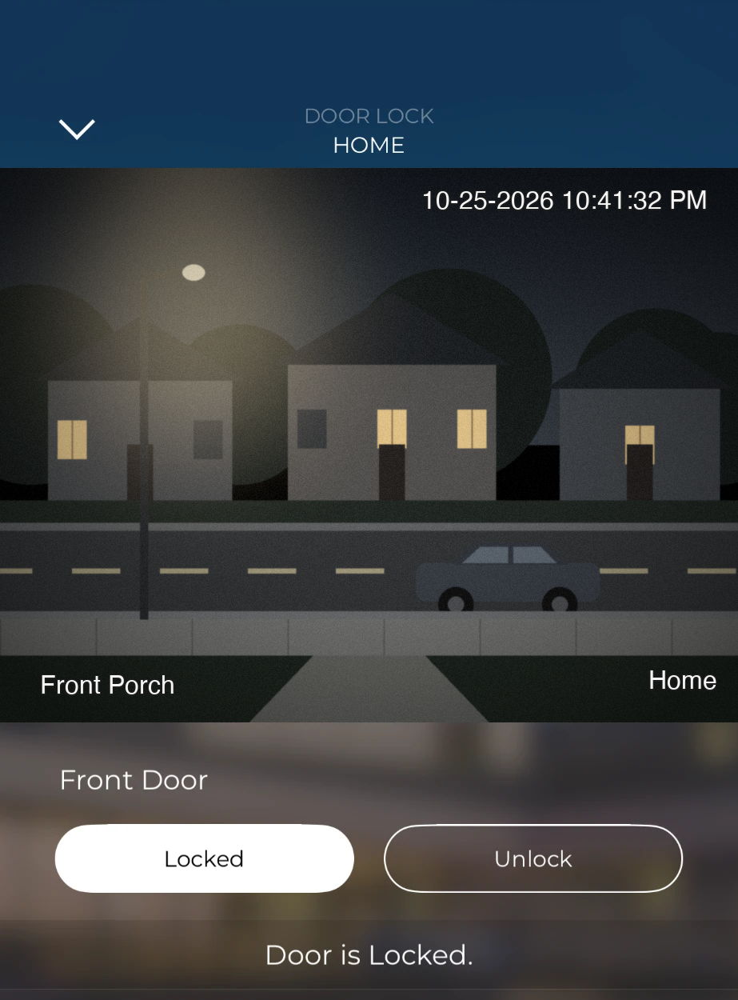

# HaloKey

Kwikset Halo Wi-Fi smart locks in Savant: lock and unlock from the Savant app's Door Lock screen, live status pushed from Kwikset in seconds, battery and offline alerts, and **who did it** (keypad code, thumb turn, Kwikset app or Savant), all as Blueprint states for screens and triggers.



- **Native Savant Door Lock service**, laid out like Savant's own August profile. One component covers up to 8 locks.
- **Live status** by Kwikset's real-time push, with a 5-minute safety poll. Status is never assumed: after a command, the lock shows *Locking…* until Kwikset confirms.
- **Who did it:** `LOCKn_LAST_SOURCE` (Keypad / Manual / App / Savant) and `LOCKn_LAST_USER` (the user code's name).
- **Safe by design:** the Kwikset password is never stored; only this host can connect to the bridge by default; a Blueprint switch makes Savant lock-only.
- **Easy to find in Blueprint:** search *Kwikset*, *Halo*, *Smart Lock* or *Deadbolt*. The profile is listed as **Kwikset HaloLink**, HaloKey's original name, which the bridge service, `halolink` command and `~/HaloLink` folder also keep.
- **Runs on the Savant Mac mini Pro host** as a small background service with an installer, uninstaller and a `halolink` command. Linux works too.

Tested with the original Kwikset Halo Touchscreen Wi-Fi Smart Lock and a Savant Mac mini Pro host. Halo Touch, Halo Select and Select Plus use the same Kwikset cloud and should work. Bluetooth-only (Aura) and Z-Wave/Zigbee Kwikset locks are not supported.

## Quick start

```
cd HaloKey/macos
sudo ./install.sh
halolink login
```

Then in Blueprint:

1. Import `profile/blueprint-import/componentProfiles/kwikset_halolink.xml` (keep the file name). Importing from that folder also brings in the icon and the full manual on the component's **Documentation** tab.
2. Add **Kwikset HaloLink** (search *Kwikset* or *Halo*) to the layout and set its Ethernet IP to the host.
3. In the Door Lock data table, add one Lock per lock: address = lock number from `halolink list`, Status State `DoorLockStatus_n`, Error State `DoorLockError_n`.
4. Upload.

**Read [MANUAL.pdf](MANUAL.pdf)** (or [MANUAL.md](MANUAL.md), or the component's Documentation tab in Blueprint) for setup, the data table, programming, security, troubleshooting and the full state list.

## Package contents

| Path | |
|---|---|
| `MANUAL.pdf`, `MANUAL.md` | User manual |
| `STATES.md` | Every state |
| `CHANGELOG.md` | Release history |
| `profile/blueprint-import/` | Import from here: Blueprint profile, Documentation tab page, icon |
| `profile/` | Profile generator and icon source |
| `bridge/` | Bridge service and default config |
| `macos/` | Installer, uninstaller, `halolink` control command |
| `linux/` | systemd unit |
| `vendor/` | Python 3.9-compatible aiokwikset wheel |
| `tests/` | Tests against a simulated Kwikset cloud |

## Disclaimer

HaloKey is an independent community project, not affiliated with, endorsed by, or supported by Kwikset or Savant Systems, Inc. It uses the same cloud service as the Kwikset app, which Kwikset doesn't publish or support for third parties, so a Kwikset change could break it. A door lock is a security device: test your setup, and keep a key or code that works without Savant.

Built on [aiokwikset](https://github.com/explosivo22/aiokwikset) by Brad Barbour (Apache License 2.0). HaloKey itself is MIT licensed.
